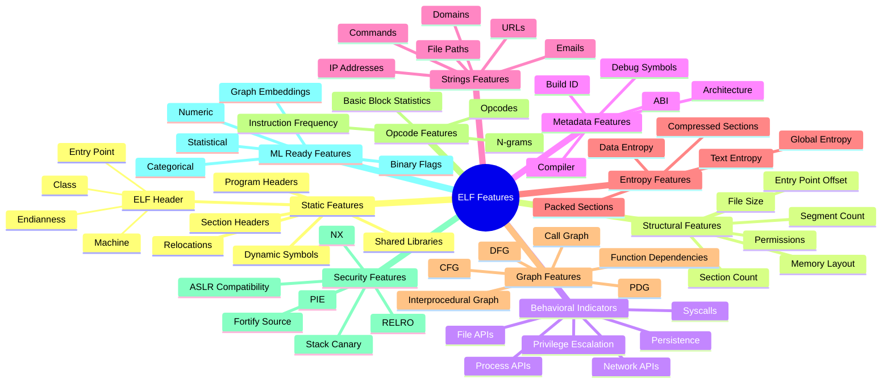

    

        
    

# **`Awesome`** [ELF](https://wikipedia.org/wiki/Executable_and_Linkable_Format) (_[Executable and Linkable Format]()_) [Feature](https://wikipedia.org/wiki/Feature_(machine_learning)) [Extractor](https://wikipedia.org/wiki/Comparison_of_executable_file_formats) 

    
    &nbsp;
    
    &nbsp;
    
    

## 📖 Contents
- [My Other Awesome Lists](#my-other-awesome-lists)
- [Contributing](#contributing)
- [Contributors](#contributors)

## ELF parsing tools
* [LIEF](https://lief.re/) - **`LIEF`** (Library to Instrument Executable Formats) project aims at providing a cross platform library to parse, modify and abstract ELF, PE and MachO formats.
* [pyelftools ](https://github.com/eliben/pyelftools) - **`pyelftools`** is a pure-Python library for parsing and analyzing ELF files and DWARF debugging information.
* [readelf](https://man7.org/linux/man-pages/man1/readelf.1.html) - **`readelf`** displays information about one or more ELF format object files.

## 1. Raw Binary Features
* Byte Histogram
* Byte Entropy
* Byte N-grams
* Image Representation Features

## 2. ELF Parsing Features
* ELF Header
* Program Header Table
* Section Header Table
* Dynamic Linking Information

## 3. Symbol-Based Features
* Imported Functions
* Exported Functions
* Dynamic Symbols
* Relocations

## 4. String-Based Features
* URLs
* Domains
* IP Addresses
* Commands
* File Paths

## 5. Opcode Features
* Instruction Frequency
* Opcode N-Grams
* Control Instructions
* Arithmetic Instructions

## 6. Security Hardening Features
* NX Enabled
* PIE Enabled
* RELRO Level
* Stack Canary
* Fortify Source

## 7. Graph-Based Features
* Call Graph (CG)
* Control Flow Graph (CFG)
* Data Flow Graph (DFG)
* Program Dependency Graph (PDG)
* Code Property Graph (CPG)

## 8. Statistical Features
* Function Count
* Basic Block Count
* Cyclomatic Complexity
* Average Function Size
* Section Statistics

## 9. Malware-Specific Indicators
* Shell Execution Functions
* Network Communication Functions
* Crypto APIs
* Anti-Debugging Artifacts
* Persistence Mechanisms
* Privilege Escalation Indicators

## 10. GNN-Oriented Graph Features
* Node Degree
* Centrality Metrics
* Graph Density
* Graph Embeddings
* Weisfeiler-Lehman Features
* Graph2Vec Features
* Node2Vec Features

## 

### My Other Awesome Lists
You can access the my other awesome lists [here](https://cyberthreatdefence.com/my_awesome_lists)

### Contributing

[Contributions of any kind welcome, just follow the guidelines](contributing.md)!

### Contributors

[Thanks goes to these contributors](https://github.com/cybersecurity-dev/awesome-smartcontract-datasets/graphs/contributors)!

[🔼 Back to top](#awesome-elf-feature-extractor-)